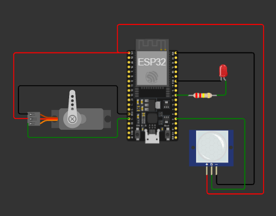
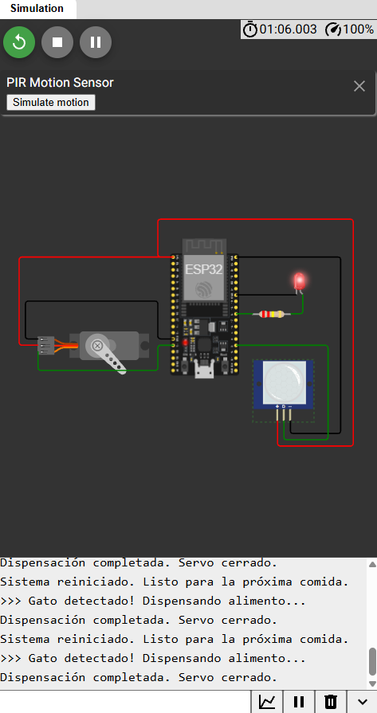

# Comedero Inteligente para Gatos

Proyecto del curso EL-1200 Introducción a la Electrónica, TEC, II semestre 2026.

**Integrantes:** Sebastián Valverde Silva

## Descripción
Comedero automático que dispensa alimento solo cuando detecta al gato y evita servir de más si el gato se queda frente al plato.

## Funcionamiento
- El sensor PIR detecta la presencia del gato.
- El servomotor abre la compuerta 1,5 segundos y la vuelve a cerrar.
- El LED indica que se está sirviendo.
- Una variable booleana (`dispensado`) evita que se sirva otra vez mientras el gato sigue ahí.

## Conexiones
| Componente | Pin del ESP32 |
| :--- | :--- |
| Sensor PIR | GPIO 2 |
| Servomotor | GPIO 13 |
| LED (con 220 Ω) | GPIO 5 |
| Alimentación | 3V3 y GND |

## Simulación
Proyecto en Wokwi: [Ver simulación interactiva](https://wokwi.com/projects/481001785295433729)

## Código
Ver la carpeta `firmware/`. Biblioteca usada: `ESP32Servo`.

## Evidencia

Video demostrativo en YouTube: [Ver video](https://youtu.be/me3JFNTOoPM)

## Mejoras futuras
- Agregar un módulo de reloj en tiempo real (RTC) para restringir horarios de alimentación.
- Incorporar un sensor ultrasónico en el depósito para alertar por Wi-Fi cuando quede poca comida.
